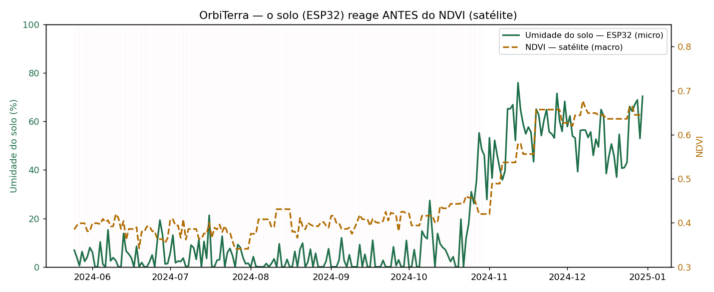
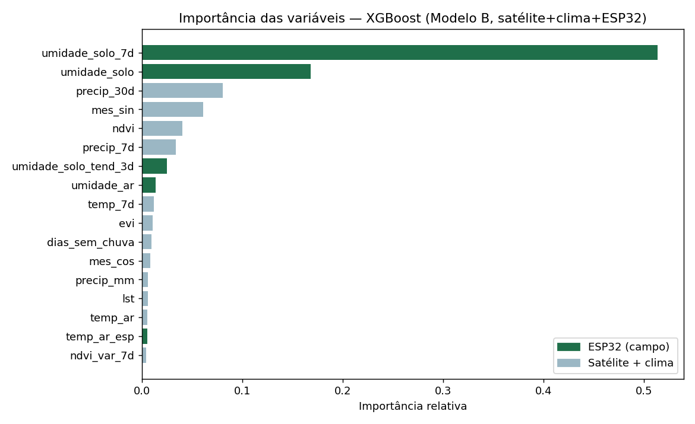
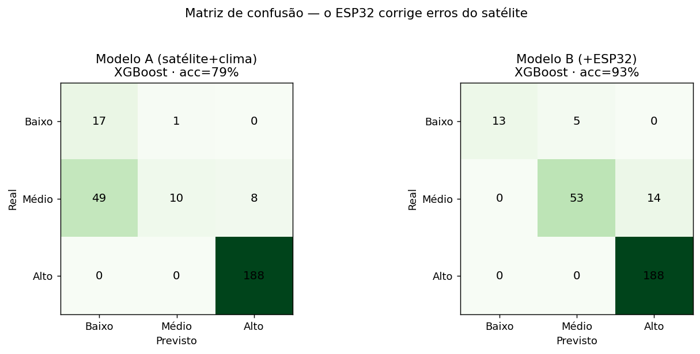
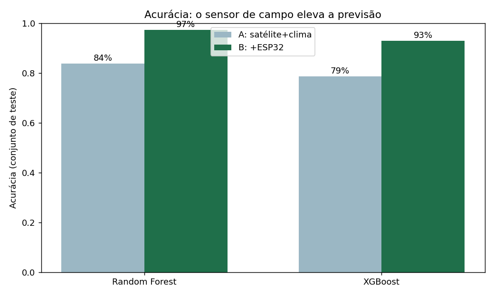

# FIAP - Faculdade de Informática e Administração Paulista

<p align="center">
<a href="https://www.fiap.com.br/">
  
</a>
</p>

<br>

# 🛰️ OrbiTerra — Inteligência espacial contra o estresse hídrico no café

## 👨‍🎓 Integrantes:
- <a href="https://github.com/KaiqueSavi">Kaique Savi — RM562072</a>
- Willian — RM571013


## 📜 Descrição

O **OrbiTerra** é uma Prova de Conceito (POC) da **Global Solution 2026.1**, cujo tema é a
**economia espacial**. Ele responde à pergunta-guia da GS — *"Como a tecnologia espacial pode ser
utilizada para melhorar a vida das pessoas, tornar processos mais eficientes e criar novas
oportunidades na Terra ou fora dela?"* — usando **observação da Terra** (o maior mercado *downstream*
da economia espacial) para **prever o risco de estresse hídrico em lavouras de café arábica** no
corredor **Mogiana Paulista / Sul de Minas**.

A solução combina **três olhares** sobre a lavoura e os funde com **Inteligência Artificial**:

- 🛰️ **Olho macro (satélite):** índices de vegetação (NDVI/EVI) e temperatura de superfície (LST),
  dando a visão histórica e espacial — mas com **defasagem** e **lacunas de nuvem**.
- 📟 **Olho micro (ESP32):** uma estação de campo mede a **umidade do solo na zona da raiz** e
  temperatura/umidade do ar em alta frequência, enxergando o que o satélite não vê.
- 🧠 **Cérebro (IA):** modelos **XGBoost** e **Random Forest** classificam o risco de estresse
  hídrico dos **próximos 7 dias** em três níveis (Baixo / Médio / Alto).

**A tese e o resultado:** o solo (ESP32) reage **antes** do NDVI (satélite). Para provar que o
sensor agrega valor, treinamos os mesmos algoritmos em dois cenários — **Modelo A** (só satélite +
clima) e **Modelo B** (A + ESP32) — com **validação temporal** (treina no passado, testa no futuro):

| Algoritmo | A (satélite+clima) | B (+ESP32) | Ganho |
|---|---|---|---|
| **Random Forest** | 83,9% | **97,4%** | **+13,6 pt** |
| **XGBoost** | 78,8% | **93,0%** | **+14,3 pt** |

> Baseline (chutar a classe majoritária) = 68,9%. A variável mais importante do Modelo B é a
> **umidade do solo do ESP32**. Mais ainda: o Modelo A **subestima** o risco (classifica 49 dias de
> risco Médio como Baixo — deixaria o produtor sem irrigar), e o **Modelo B corrige** esse erro.
> Ou seja: **o sensor de campo se paga.**

O painel de decisão (Streamlit) traduz tudo em ação: mapa do talhão, risco previsto, série de NDVI ×
umidade do solo e recomendação de manejo.

> **Decisões de projeto (honestidade científica):** o ESP32 é **simulado** (a POC permite; o
> `emulador_esp32.py` reproduz o firmware). Os dados são **sintéticos, mas fisicamente plausíveis**
> (balanço hídrico tipo "balde", NDVI atrasado, lacunas de nuvem), com **seed fixa** ⇒ 100%
> reproduzível. **Não há vazamento de dados:** o balanço hídrico latente do solo é o *alvo* (define o
> rótulo), nunca uma *feature* — o ESP32 apenas o *observa com ruído*. Caminho futuro: plugar dados
> reais via Google Earth Engine (Sentinel-2 / MODIS / CHIRPS).

### Gráficos gerados

| Solo reage antes do NDVI | Importância das variáveis |
|---|---|
|  |  |

| Matriz de confusão (A × B) | Acurácia (A × B) |
|---|---|
|  |  |


## 📁 Estrutura de pastas

Dentre os arquivos e pastas presentes na raiz do projeto, definem-se:

- <b>src</b>: Todo o código-fonte. `simulador_dados.py` (gera os dados satélite+clima+ESP32 e o
  rótulo de risco), `treino_modelo.py` (engenharia de variáveis, treino e comparação RF × XGBoost,
  gráficos e métricas), `emulador_esp32.py` (firmware do ESP32 **simulado**, emitindo leituras em
  JSON), `dashboard.py` (painel de decisão em Streamlit) e `analise_orbiterra.ipynb` (notebook de
  análise/EDA + ML, reaproveitando os módulos acima, com as saídas e gráficos já renderizados).

- <b>data</b>: Dados utilizados — `lavoura_cafe.csv` (base sintética gerada) e `metricas.txt`
  (resumo dos resultados do treino).

- <b>docs</b>: Documentação e saídas visuais — `OrbiTerra_Entrega_GS2026.pdf` (PDF de entrega),
  `OrbiTerra_Conceito.pdf` (conceito), `roteiro_video.md` (roteiro do vídeo), `arquitetura.md`
  (fluxograma das 5 camadas) e a pasta `imagens/` com os 4 gráficos gerados pelo treino.

- <b>requirements.txt</b>: Dependências do projeto (testadas em Python 3.14).

- <b>README.md</b>: Este arquivo, guia geral do projeto.


## 📎 Links e Observações

- <b>Repositório do projeto</b>: https://github.com/KaiqueSavi/OrbiTerra-GS2026
- <b>Explicação de decisões técnicas</b>: detalhadas na seção *Descrição* acima e no PDF de entrega
  (`docs/OrbiTerra_Entrega_GS2026.pdf`).


## 🔧 Como executar o código

**Pré-requisitos:** Python 3.11+ (testado em 3.14). Bibliotecas em `requirements.txt`
(numpy, pandas, scikit-learn, xgboost, matplotlib, streamlit).

```bash
# 1) Clonar o repositório e entrar na pasta do projeto
git clone [URL-DO-REPOSITORIO]
cd OrbiTerra-GS2026

# 2) Criar o ambiente virtual e instalar as dependências
python3 -m venv .venv
source .venv/bin/activate          # Windows: .venv\Scripts\activate
pip install -r requirements.txt

# 3) Gerar os dados (satélite + clima + ESP32 + rótulo de risco)
python src/simulador_dados.py

# 4) Treinar e comparar os modelos (gera gráficos em docs/imagens/ e data/metricas.txt)
python src/treino_modelo.py

# 5) Emular a estação ESP32 em "tempo real" (leituras em JSON)
python src/emulador_esp32.py            # opções: --n 30 --intervalo 0.5 --enviar <url>

# 6) Abrir o painel de decisão (interativo)
streamlit run src/dashboard.py

# 7) (Opcional) Abrir o notebook de análise — já vem com as saídas salvas
pip install jupyter          # só para re-executar/editar
jupyter notebook src/analise_orbiterra.ipynb
```


## 🗃 Histórico de lançamentos

* 0.1.0 - 09/06/2026
    * MVP funcional: simulador de dados, treino RF/XGBoost (Modelo A × B), emulador ESP32 e
      painel Streamlit. Resultado: o sensor de campo eleva a previsão (RF +13,6 pt; XGB +14,3 pt).

---


## 📋 Licença

<p xmlns:cc="http://creativecommons.org/ns#" xmlns:dct="http://purl.org/dc/terms/"><a property="dct:title" rel="cc:attributionURL" href="https://github.com/SabrinaOtoni/TEMPLATE-FIAP-GRAD-ON-IA">MODELO GIT FIAP</a> por <a rel="cc:attributionURL dct:creator" property="cc:attributionName" href="https://fiap.com.br">FIAP</a> está licenciado sobre <a href="http://creativecommons.org/licenses/by/4.0/?ref=chooser-v1" target="_blank" rel="license noopener noreferrer" style="display:inline-block;">Attribution 4.0 International</a>.</p>
