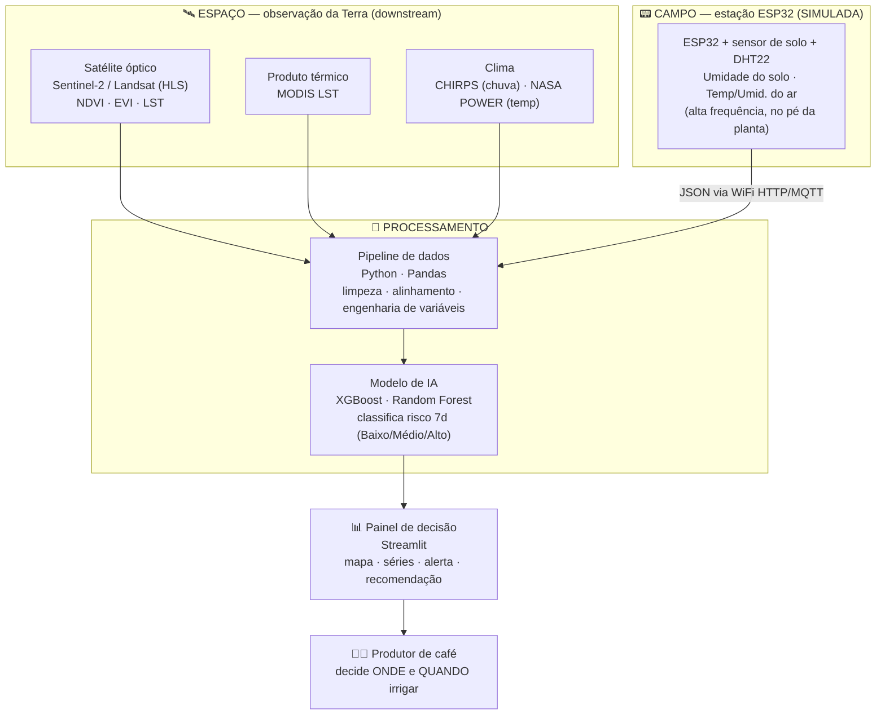

# Arquitetura do OrbiTerra (5 camadas)

A solução organiza-se em cinco camadas: três fontes de dado (satélite, clima e ESP32), o pipeline
que as funde e o modelo de IA, e o painel que entrega a decisão.

## Por que o ESP32 não é enfeite

O **balanço hídrico do solo** (água na zona da raiz) é a *verdade* que define o risco — é o **alvo**
do modelo, nunca uma variável de entrada.

- O **satélite** só percebe a falta d'água **depois** que ela chega à folha (NDVI), e ainda sofre
  **lacunas de nuvem** (semanas sem imagem limpa na estação chuvosa) → indicador **atrasado**.
- O **ESP32** **observa** o solo **quase em tempo real** (com ruído) → indicador **antecipado**.

**Ganho concreto:** numa estiagem de 10 dias, o satélite passa no dia 1 (NDVI normal), nubla até o
dia 8 e só "enxerga" a queda no dia 9 — tarde demais. O ESP32 vê a umidade despencar desde o dia 2 e
dispara o alerta no dia 3: **~6 dias de antecedência** para irrigar.

## Fluxo resumido (texto)

1. **Coleta** — satélite (NDVI/EVI/LST), clima (chuva/temperatura) e ESP32 (umidade do solo, ar).
2. **Fusão** — Pandas alinha tudo no tempo e cria variáveis derivadas (chuva acumulada, dias sem
   chuva, média/tendência da umidade do solo, sazonalidade).
3. **Previsão** — XGBoost/Random Forest classificam o risco dos próximos 7 dias.
4. **Decisão** — o painel mostra o risco e a recomendação de manejo.
